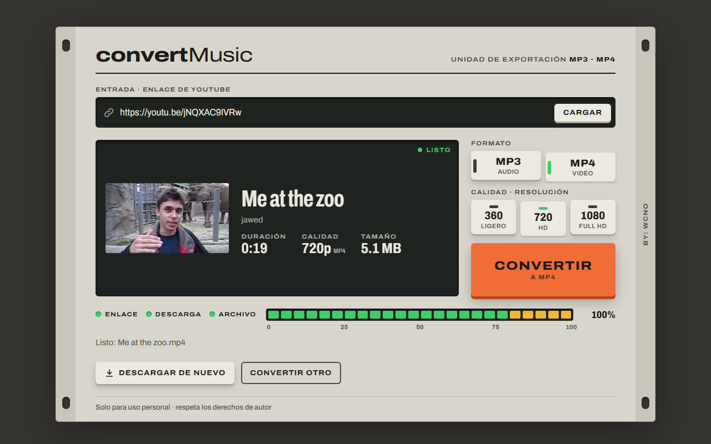

# convertMusic

Turn a YouTube video into an **MP3** (audio) or **MP4** (video). Paste a link, check the preview, pick a format and quality, and download.

**Live:** <https://convert-music-pink.vercel.app/convert> (see [YouTube and cloud servers](#youtube-and-cloud-servers) before relying on it)



The interface is designed like a piece of studio rack gear: the link goes into the input slot, the video shows up in the display with its length, quality and file size, and an LED meter fills with the **real** progress of the download, the conversion and the transfer to your browser. The UI is in Spanish.

## Features

- **MP3 or MP4**: audio at 128, 192 or 320 kbps, or video at up to 360p, 720p or 1080p (H.264 + AAC, so it plays everywhere).
- **Video preview**: title, channel, length, thumbnail and estimated file size before you convert.
- **Live progress**: the meter follows the real download, then the conversion, then the transfer.
- **Clear errors**: bad links, private, unavailable, too-long or blocked videos, dropped connections; each gets a plain message that says what to do.
- **Nothing stored**: each conversion runs in its own temporary folder, deleted as soon as the file has been sent.
- **Runs anywhere**: locally, or on Vercel. FFmpeg and Deno come from pip, so nothing else needs installing.
- **Works without JavaScript**: the form still converts and downloads in one step.
- Accepts `youtube.com/watch`, `youtu.be`, `music.youtube.com`, `/shorts/`, `/live/` and `/embed/` links. Playlists are ignored; only the video in the link is converted.

## Run it locally (recommended)

Requires Python 3.10 or newer.

```bash
git clone https://github.com/Wcno/convertMusic.git
cd convertMusic

python -m venv .venv
# Windows
.venv\Scripts\activate
# macOS / Linux
source .venv/bin/activate

pip install -r requirements.txt
python app.py
```

Open <http://127.0.0.1:5000>.

`requirements.txt` installs yt-dlp, [Deno](https://deno.com) (yt-dlp needs a JavaScript runtime to read YouTube) and a bundled FFmpeg binary (`imageio-ffmpeg`). If FFmpeg is already installed on your system, that copy is used instead.

## YouTube and cloud servers

YouTube refuses most requests that come from data centres (Vercel, AWS, Google Cloud and similar) with **"Sign in to confirm you're not a bot"**. This is YouTube's decision, not a bug in the app, and it can't be fixed in code. When it happens the page says so and suggests the options below.

1. **Run it on your own computer** (above). Home connections are normally not blocked, so this is the simplest and most reliable option.
2. **Sign the server in as you.** Export the cookies of a browser where you are signed in to YouTube as a `cookies.txt` file ([yt-dlp's guide](https://github.com/yt-dlp/yt-dlp/wiki/Extractors#exporting-youtube-cookies)), and paste its full text into a `YTDLP_COOKIES` environment variable in **Vercel → Project → Settings → Environment Variables**, then redeploy. Downloads then use your account, so:
   - treat that variable like a password;
   - YouTube may still refuse, and can flag accounts used this way;
   - cookies expire, so you'll need to refresh them now and then.

Even when downloads are allowed, YouTube may briefly limit an IP that downloads a lot (HTTP 429). The page shows "YouTube está limitando las descargas…"; wait a few minutes.

## Deploy to Vercel

The repo is ready for Vercel:

- `api/index.py` imports the Flask `app`, and `vercel.json` rewrites every path to it.
- `package.json` only pins Node.js 24 for Vercel's build tooling (the app itself is Python).
- `vercel.json` allows each request up to 60 seconds and leaves tests and docs out of the bundle. That is plenty for songs and short videos. For longer ones, turn on **Fluid compute** in Vercel → Project → Settings → Functions, raise `maxDuration` to 300 and set the duration variables below.
- `.python-version` pins Python 3.12.

Push to `master` and Vercel builds and deploys it. The page is served at both `/` and `/convert`.

Optional environment variables:

| Variable | Default | Purpose |
|---|---|---|
| `YTDLP_COOKIES` | – | Text of your `cookies.txt` (see above). |
| `YTDLP_PROXY` | – | Proxy URL for outgoing requests, if your network requires one. |
| `MAX_DURATION_SECONDS` | 900 on Vercel, 10800 locally | Longest video accepted for MP3, in seconds. |
| `MAX_VIDEO_DURATION_SECONDS` | 600 on Vercel, 10800 locally | Longest video accepted for MP4. Video files are much larger, and Vercel's temporary disk holds about 500 MB. |
| `FFMPEG_LOCATION` | – | Path to a specific FFmpeg binary or folder. |

## Tests

```bash
pip install -r requirements-dev.txt
python -m pytest
```

102 tests cover:

- link validation;
- formats and quality tiers;
- file naming, including non-Latin titles;
- error messages;
- configuration: cookies, proxy, bundled FFmpeg and Deno;
- progress and cleanup of a conversion;
- every route and the streamed reply format, for MP3 and MP4;
- the no-JavaScript fallback.

They replace yt-dlp with a fake downloader, so they run offline in under a second.

To also run real conversions against YouTube (needs internet, and an IP that YouTube is not blocking):

```bash
# Windows PowerShell
$env:RUN_NETWORK_TESTS=1; python -m pytest
# macOS / Linux
RUN_NETWORK_TESTS=1 python -m pytest
```

## How it works

Every conversion happens inside one request, so the server keeps nothing between requests. That is what lets it run on serverless functions, where each request may land on a different machine.

```
browser ── GET  /api/info?url=…  ────────────────────▶ yt-dlp reads title, channel, thumbnail
        ── POST /api/convert {url, format, quality} ─▶ streamed reply, one JSON object per line:
               {"type":"progress","stage":"download","progress":0.42}
               {"type":"progress","stage":"convert","progress":0.8}
               {"type":"file","filename":"….mp4","title":"…","size":123456,"mimetype":"video/mp4"}
               {"type":"chunk","data":"<base64>"}   (repeated)
               {"type":"done"}      or   {"type":"error","message":"…"}
```

The browser rebuilds the file from the chunks and saves it, so "Descargar de nuevo" works without asking the server again. Because the reply is streamed, files larger than Vercel's 4.5 MB response limit still go through.

| Route | Purpose |
|---|---|
| `GET /`, `GET /convert` | The page |
| `GET /api/info?url=` | Video metadata for the preview |
| `POST /api/convert` | Convert. JSON or form body: `url`, `format` (`mp3` or `mp4`, default `mp3`), `quality` (`low`, `std` or `high`, default `std`; or an exact value such as `320` or `720p`) |
| `POST /convert` | No-JavaScript fallback: converts and returns the file itself |

Quality tiers:

| Tier | MP3 | MP4 (maximum) |
|---|---|---|
| `low` | 128 kbps | 360p |
| `std` | 192 kbps | 720p |
| `high` | 320 kbps | 1080p |

### Project layout

```
app.py              Flask routes and the streamed reply format
converter.py        Link/format checks, yt-dlp/FFmpeg/Deno setup, convert() generator
templates/index.html
static/styles.css   Rack-unit design
static/app.js       Preview, format switch, stream reading, progress meter and download
tests/              pytest suite (fake downloader, no network)
api/index.py        Vercel entry point (imports app)
vercel.json         Function duration, bundled files, rewrite to api/index.py
```

`converter.convert(url, fmt, quality)` is the core: it yields progress events and then one result whose file stays on disk until the generator finishes. A test can pass `downloader=` to replace yt-dlp.

## Troubleshooting

| Message | Fix |
|---|---|
| "YouTube no permite descargas desde servidores en la nube…" | See [YouTube and cloud servers](#youtube-and-cloud-servers). |
| "YouTube está limitando las descargas…" | Too many requests from this IP in a short time. Wait a few minutes. |
| "Este video no está disponible en esa calidad…" | Choose a lower quality. |
| "El video es demasiado largo…" | Raise `MAX_DURATION_SECONDS` / `MAX_VIDEO_DURATION_SECONDS`, bearing in mind Vercel's time limit per request. |
| "El archivo es demasiado grande para este servidor…" | Use a lower MP4 quality or a shorter video. |
| "YouTube no dejó descargar este video…" | YouTube changed something. Update yt-dlp: `pip install -U "yt-dlp[default]"`, then redeploy. |
| "La conexión se cortó antes de terminar…" | The request hit the time limit or the network dropped. Try a shorter video or try again. |

## Note

For personal use only. Download only content you have the rights to, and respect YouTube's Terms of Service and the creators' copyright.

---

By: wcno
